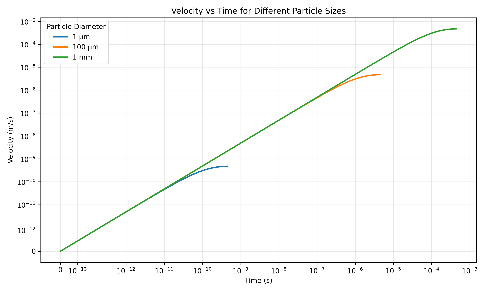
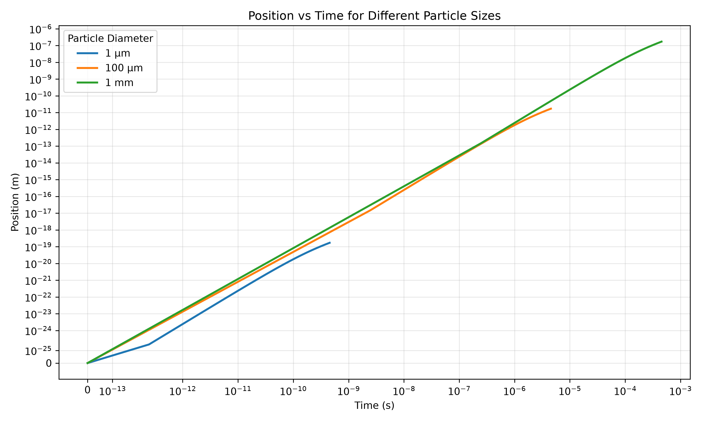

# Particle Settling Simulator

An interactive, browser-based simulation of a single particle settling (or rising) through a quiescent fluid in a
vertical column. Weight, buoyancy and drag enter Newton's second law, which is integrated in time. You can switch
between three drag laws and turn wall, concentration and particle-shape effects on or off. The particle's motion,
forces, dimensionless numbers and plots update live as you move the sliders.

Built as the computational part of **Project 5: Particle settling** in *MS2280 Transport Phenomena in Materials
Processing*.

- **No installation and no build step:** plain HTML, CSS and JavaScript, served directly by GitHub Pages.
- **Real calculations:** every number, curve and animation frame comes from the governing equations. Nothing is
  hard-coded or randomised.
- **Self-checking:** 13 physical and numerical checks re-run on every change, including an RK4 vs analytical
  comparison and an energy balance.
- **Data export:** CSV export of the time history and of recorded trials, ready for Excel or Python.

---

## Contents

- [Quick start](#quick-start)
- [Features](#features)
- [Example results](#example-results)
- [Physics model](#physics-model)
- [Numerical method](#numerical-method)
- [Validation](#validation)
- [Data export](#data-export)
- [Validity limits and warnings](#validity-limits-and-warnings)
- [Assumptions and limitations](#assumptions-and-limitations)
- [Project structure](#project-structure)
- [References](#references)

---

## Quick start

The simulator is published with **GitHub Pages** and runs in any modern browser (Chrome, Edge, Firefox, Safari).

[Simulator](https://bsn2810.github.io/TPMP-project/)

> **Graphs:** the plots use [Plotly](https://plotly.com/javascript/), loaded from a CDN, so no library files need to
> be committed.
>
> **After updating the code:** the script links carry a version tag (`?v=…`), so a normal reload picks up changes.
> If a browser still runs old code, use a hard reload (Cmd+Shift+R or Ctrl+Shift+R).

---

## Features

### Inputs (slider and editable value box for every variable)

| Variable | Symbol | Slider range | Scale | Notes |
|---|---|---|---|---|
| Particle diameter | $d$ | 1 µm – 50 mm | log | volume-equivalent diameter for non-spherical particles; mm/µm display |
| Particle density | $\rho_p$ | 100 – 12 000 kg/m³ | linear | |
| Sphericity | $\psi$ | 0.3 – 1 | linear | active only with the non-spherical toggle |
| Fluid density | $\rho_f$ | 500 – 2000 kg/m³ | linear | |
| Dynamic viscosity | $\mu$ | 10⁻⁵ – 10 Pa·s | log | Pa·s / mPa·s display |
| Gravity | $g$ | 1 – 25 m/s² | linear | default 9.81 |
| Column height | $H$ | 0.05 – 3 m | linear | |
| Column diameter | $D$ | 5 – 300 mm | linear | active only with the wall-effect toggle |
| Solids volume fraction | $\varphi$ | 0 – 0.6 | linear | concentration toggle |
| Richardson–Zaki exponent | $n$ | 2 – 5.5 | linear | default 4.65 |
| Initial velocity | $v_0$ | 0 – 3 m/s | square root | entry speed in the direction of motion; quick buttons for $0$, $\tfrac12 v_t$, $2v_t$ |

You can type exact values, including values outside the slider range, in the box beside each slider. There are four
presets:
- glass bead in glycerol (Stokes regime),
- sand in water (intermediate regime),
- steel ball in water (Newton regime),
- polyethylene bead in water (rises).

### Models
- **Drag law (choose one):** Stokes, Newton ($C_D = 0.44$) or Schiller–Naumann.
- **Three independent toggles:**
  - **Wall effects** (Francis 1933),
  - **Concentration effects** (Richardson–Zaki 1954),
  - **Non-spherical particle** (Haider–Levenspiel 1989). When this is on, it replaces the selected spherical drag law.

### Outputs
- **Animated settling column:** one column and one particle, whose position follows the computed $x(t)$.
  - Start, Pause, Resume and Reset controls; playback speed is automatic (≈ 8 s per run) or 0.01× to 1000×.
  - Live readouts of velocity, percentage of terminal velocity, elapsed time and distance travelled.
  - A "terminal velocity reached" indicator.
  - Changing a parameter during a run stops it, recalculates and resets to $t = 0$.
- **Results panel:**
  - Forces: $W$, $B$, $W-B$, $F_D$ and the force-balance residual.
  - Power balance at terminal velocity.
  - $Re$, $Ar$ and $C_D$, the flow regime and the drag-law validity.
  - Terminal velocity before and after each correction, with the percentage change.
  - $t_{95}$, $t_{99}$ and the time to travel $H$.
- **Plots:**
  - Velocity vs time, with a zoom on the acceleration phase.
  - Position vs time.
  - $C_D$ vs $Re$ (log–log) for all drag laws, with the operating point marked.
- **Warnings** whenever an input or result is outside a model's range of validity.
- **Recorded trials** table with CSV export ([see below](#data-export)).

---

## Example results

Effect of particle size on the acceleration phase. The three runs below use **Stokes' law**, a glass bead
($\rho_p = 2500$ kg/m³) in glycerol ($\rho_f = 1260$ kg/m³, $\mu = 1.41$ Pa·s), released from rest, with wall,
concentration and shape effects off. Only the diameter changes. The curves were plotted from the simulator's
**Export results** CSV files (`data_1.csv`–`data_3.csv`) and use symmetric-log axes so all three fit on one figure.





| d | $v_t$ (m/s) | $t_{99}$ (s) | Time to travel $H = 0.5$ m | $Re$ |
|---|---|---|---|---|
| 1 µm | 4.79 × 10⁻¹⁰ | 4.54 × 10⁻¹⁰ | 1.04 × 10⁹ s (≈ 33 years) | 4.3 × 10⁻¹³ |
| 100 µm | 4.79 × 10⁻⁶ | 4.54 × 10⁻⁶ | 1.04 × 10⁵ s (≈ 29 h) | 4.3 × 10⁻⁷ |
| 1 mm | 4.79 × 10⁻⁴ | 4.54 × 10⁻⁴ | 1.04 × 10³ s (≈ 17 min) | 4.3 × 10⁻⁴ |

**What the plots show:**
- **All three particles start on the same line.** Just after release the drag is negligible, so every particle has
  the same acceleration $a_0 = (\rho_p-\rho_f)g/\rho_p \approx 4.87$ m/s², independent of size. That gives
  $v \approx a_0 t$ (slope 1 on the log axes) and $x \approx \tfrac12 a_0 t^2$ (slope 2).
- **Each curve then levels off at its own terminal velocity.** In the Stokes regime $v_t \propto d^2$, so a
  10× larger diameter settles 100× faster.
- **The time to reach terminal velocity also scales as $d^2$**, because $\tau = \rho_p d^2/(18\mu)$ and
  $t_{99} = \tau\ln 100$. Even the 1 mm bead reaches terminal velocity in under half a millisecond, which is why
  settling is usually analysed with $v_t$ alone.
- **All three runs are well inside the Stokes regime** ($Re \ll 0.1$), so the drag law is valid for each of them.

---

## Physics model

Sign convention: $z$ points **downward**, so a positive velocity means settling and a negative velocity means rising.

### Forces and equation of motion

```math
V_p = \frac{\pi d^3}{6}, \qquad A_p = \frac{\pi d^2}{4}, \qquad
W = \rho_p g V_p, \qquad B = \rho_f g V_p
```

```math
\rho_p V_p \frac{dv}{dt} = (\rho_p - \rho_f)\, g V_p - F_D(v), \qquad \frac{dx}{dt} = v, \qquad v(0) = v_0,\; x(0) = 0
```

```math
F_D = \tfrac12 C_D \rho_f v^2 A_p, \qquad Re = \frac{\rho_f |v| d}{\mu}
```

Drag always opposes the motion: in the code $F_D \propto |v|\,v$.

### Drag laws

| Law | Drag | Terminal velocity | Range used |
|---|---|---|---|
| Stokes | $F_D = 3\pi\mu d v$ $\;(C_D = 24/Re)$ | $v_t = \dfrac{(\rho_p-\rho_f) g d^2}{18\mu}$ | $Re \le 0.1$ |
| Newton | $C_D = 0.44$ | $v_t = \sqrt{\dfrac{4(\rho_p-\rho_f) g d}{3 C_D \rho_f}}$ | $800 \le Re \le 2\times10^5$ |
| Schiller–Naumann | $C_D = \dfrac{24}{Re}\left(1 + 0.15\,Re^{0.687}\right)$ | iterative (below) | $Re \le 800$ |
| Haider–Levenspiel | $C_D = \dfrac{24}{Re}\left(1 + A\,Re^{B}\right) + \dfrac{C}{1 + K/Re}$ | iterative | $Re < 25\,000,\ \psi \ge 0.67$ |

**Iterative terminal velocity** (Schiller–Naumann, Haider–Levenspiel):
1. Start from the Stokes velocity.
2. Compute $Re$, then $C_D$, then $v_{k+1} = \sqrt{4(\rho_p-\rho_f) g d / (3\rho_f C_{D,k})}$.
3. Repeat until $|v_{k+1}-v_k|/v_{k+1} < 10^{-6}$. The app shows the number of iterations.

**Archimedes number** (used to recommend a drag law):

```math
Ar = \frac{\rho_f (\rho_p-\rho_f) g d^3}{\mu^2}, \qquad Re_{\text{Stokes}} = \frac{Ar}{18}
```

### Corrections

**Wall effect** (Francis 1933), with $\lambda = d/D$:

```math
f_w = \left[\frac{1-\lambda}{1-0.475\,\lambda}\right]^4, \qquad v_{\text{wall}} = f_w\, v_t
```

**Hindered settling** (Richardson–Zaki 1954). This is an empirical correction: the particle represents one member of
a uniform suspension of volume fraction $\varphi$.

```math
v_h = v_t\,(1-\varphi)^n, \qquad n = 4.65 \text{ by default}
```

**Non-spherical particles** (Haider–Levenspiel 1989), with sphericity $\psi$ = surface area of the equal-volume
sphere / actual surface area:

```math
\begin{aligned}
A &= \exp(2.3288 - 6.4581\psi + 2.4486\psi^2) \\
B &= 0.0964 + 0.5565\psi \\
C &= \exp(4.905 - 13.8944\psi + 18.4222\psi^2 - 10.2599\psi^3) \\
K &= \exp(1.4681 + 12.2584\psi - 20.7322\psi^2 + 15.8855\psi^3)
\end{aligned}
```

In non-spherical mode, $d$ is the volume-equivalent diameter, used for both $Re$ and $A_p$. No shape factor is
multiplied onto another drag coefficient.

**Combining corrections.** Wall and concentration factors correct the *terminal velocity*. In the time-dependent
model they act quasi-steadily through an effective drag

```math
F_{D,\text{eff}}(v) = F_D\!\left(\frac{v}{f}\right), \qquad f = f_w\, f_{RZ},
```

so the motion tends exactly to $f\,v_t$ for every drag law. For Stokes drag this is $F_D/f$, giving
$\tau_\text{eff} = f\tau$. Multiplying the factors together is an engineering approximation, and the app warns
that the effects may interact.

### Analytical solution (Stokes drag)

```math
\tau = \frac{\rho_p d^2}{18\mu}, \qquad
v(t) = v_t + (v_0 - v_t)\,e^{-t/\tau}, \qquad
x(t) = v_t t + (v_0 - v_t)\,\tau\left(1 - e^{-t/\tau}\right)
```

For $v_0 = 0$ these reduce to $v = v_t(1-e^{-t/\tau})$ and $x = v_t[t - \tau(1-e^{-t/\tau})]$. Then
$t_{95} = \tau\ln 20 \approx 3.0\tau$ and $t_{99} = \tau\ln 100 \approx 4.6\tau$.

### Energy balance

At terminal velocity, the power released by gravity equals the power dissipated by drag:
$P_g = (\rho_p-\rho_f) g V_p v = P_d = F_D v$. Over the whole fall,

```math
(W-B)\,H + \tfrac12 m v_0^2 = \tfrac12 m v^2 + \int F_D\, v \, dt .
```

---

## Numerical method

- **Integrator:** classical 4th-order Runge–Kutta on the state $(x, v, E)$, where $E = \int F_D v\,dt$ is the energy
  dissipated by drag.
- **Adaptive step size**, re-evaluated every step:
  $\Delta t = \min\!\big(T,\ \sqrt{2H/a_0},\ m/(dF_D/dv),\ H/|v|\big)/400$.
  - $T = v_t/(|\Delta\rho| g/\rho_p)$ is the characteristic time (equal to $\tau$ for Stokes), and
    $a_0 = |\Delta\rho| g/\rho_p$.
  - The last two terms only matter while $|v| > |v_t|$: they resolve a fast deceleration when $v_0 \gg v_t$.
- **Bottom of the column:** the arrival at $x = H$ is located with a secant iteration on an exact RK4 sub-step.
- **Steady motion:** once the acceleration is negligible (relative residual $< 10^{-11}$), the motion continues as
  exactly uniform. This keeps long falls cheap; a typical recalculation takes about 10 ms.

---

## Validation

The **Physical & numerical checks** panel re-runs 13 tests on every input change. Each test re-computes the model
with perturbed inputs. Nothing in the checks is hard-coded.

| # | Check |
|---|---|
| 1 | $\rho_p = \rho_f$ gives zero net force |
| 2 | $\rho_p < \rho_f$ makes the particle rise |
| 3 | A larger $d$ settles faster |
| 4 | A higher $\mu$ settles slower, with the expected sign set by $dC_D/dRe$ of the active law ($v_t$ independent of $\mu$ for Newton) |
| 5 | A higher $\rho_f$ (at fixed $\rho_p$) gives a smaller net force |
| 6 | A higher $\varphi$ gives slower hindered settling |
| 7 | A smaller $D$ gives more wall resistance |
| 8 | A lower $\psi$ gives more drag and slower settling |
| 9 | $W - B - F_D = 0$ at terminal velocity |
| 10 | The RK4 asymptote equals the iterated $v_t$ |
| 11 | The energy balance closes |
| 12 | $v(t)$ goes monotonically from $v_0$ to $v_t$, with no overshoot |
| 13 | Stokes: RK4 matches the analytical solution |

Typical accuracy: RK4 vs analytical ≈ 10⁻¹³ in $v$ and ≈ 10⁻¹¹ in $x$; the energy-balance residual is ≈ 10⁻¹¹. Random
sweeps of more than 1 000 valid parameter sets across all slider ranges, drag laws, toggle combinations and initial
velocities passed every check.

**Observation:** the Haider–Levenspiel fit is not strictly monotonic in $\psi$ just below $\psi = 1$ at
intermediate $Re$. At $Re \approx 40$, $C_D(\psi=0.9)$ is about 0.4 % *below* $C_D(\psi=1)$. At low $\psi$ and high
$Re$, $C_D$ can rise with $Re$, so a higher viscosity can slightly *increase* $v_t$. Checks 4 and 8 test the trend
that the correlation itself predicts.

---

## Data export

### Export results — time history of the current run
The **Export results (CSV)** button writes the computed motion of the current simulation to
`settling_timeseries_<scheme>_d<diameter>_<YYYYMMDD_HHMMSS>.csv`. The file is rebuilt from the current simulation
at the moment you click.

| Column | Meaning |
|---|---|
| `Time (s)` | $t$ |
| `Particle diameter (m)` | $d$ |
| `Particle density (kg/m^3)` | $\rho_p$ |
| `Fluid density (kg/m^3)` | $\rho_f$ |
| `Velocity (m/s)` | $v(t)$, downward positive |
| `Position (m)` | $x(t)$ from the release point, downward positive |
| `Reynolds number` | $\rho_f \lvert v\rvert d/\mu$ |
| `Drag coefficient` | $\lvert F_D\rvert / (\tfrac12\rho_f v^2 A_p)$; blank at $v = 0$ |
| `Drag force (N)` | $F_D(v)$ as in the equation of motion (same sign as $v$; the effective drag when corrections are on) |
| `Net force (N)` | $(\rho_p-\rho_f) g V_p - F_D = m\,dv/dt$ |

- **Rows: the acceleration phase only.** There is one row per RK4 step from $t = 0$ to $t_{99}$, when 99 % of the
  velocity change $v_0 \to v_t$ has occurred, or to the end of the column if that comes first.
- **Format:** plain ASCII headers and 12 significant digits. It opens directly in Excel.

```python
import pandas as pd
df = pd.read_csv("settling_timeseries_Stokes_d1mm_20261122_023207.csv")
df[["Time (s)", "Velocity (m/s)", "Net force (N)"]].head()
```

### Recorded trials
Each press of **Start**, or of **Record current**, adds one trial to the *Recorded trials* table. A trial records
the drag scheme, $d$, $\rho_p$, $\rho_f$, $\mu$, $d/D$, $\varphi$, $\psi$, $Re$, the terminal velocity and the
time to travel $H$.
- When an effect is off, the table shows its default, marked "off": $d/D$ "—", $\varphi = 0$, $\psi = 1$.
- Identical consecutive settings are not recorded twice, and the log survives a page reload (browser local storage).
- **Export CSV** writes `settling_trials_<date>_<time>.csv`: UTF-8, headers with SI units in brackets, every input,
  correction factors, $Ar$, $Re$, $C_D$, the uncorrected and final $v_t$, $t_{95}$, $t_{99}$ and the validity
  status.
- **Reset trials** clears the log after a confirmation.

---

## Validity limits and warnings

| Model | Limit | Source |
|---|---|---|
| Stokes | $Re \le 0.1$ (caution up to 1) | Clift et al. (1978) |
| Schiller–Naumann | $Re \le 800$ | Schiller & Naumann (1933) |
| Newton | $800 \le Re \le 2\times10^5$ (drag crisis above) | Clift et al. (1978) |
| Haider–Levenspiel | $Re < 25\,000$, $\psi \ge 0.67$ | Haider & Levenspiel (1989) |
| Francis | $Re \lesssim 0.2$, $d/D \le 0.97$; caution for $d/D > 0.1$ | Clift et al. (1978) |
| Richardson–Zaki | $\varphi \le 0.5$; $n = 4.65$ only for $Re < 0.2$ ($n(Re)$ shown as guidance) | Richardson & Zaki (1954) |

The app also warns about:
- neutrally buoyant or lighter-than-fluid particles,
- invalid inputs,
- $d \ge D$,
- combined corrections (a multiplicative approximation).

---

## Assumptions and limitations

- Single rigid particle released into a quiescent, incompressible, isothermal Newtonian fluid.
- Added-mass and Basset history forces are neglected, consistent with $\tau = \rho_p d^2/(18\mu)$. Including added
  mass would give $\tau = (\rho_p + \rho_f/2) d^2/(18\mu)$.
- No Brownian motion, particle rotation or lateral drift. Without the wall toggle, the fluid is unbounded.
- Wall and concentration effects are empirical terminal-velocity corrections applied quasi-steadily, not derived
  forces.
- The initial velocity $v_0 \ge 0$ is along the direction of motion. With neutral buoyancy, $v_0$ is ignored.

### Notes on the theory source
The equations follow the course theory notes. Two corrections were made during implementation:
- The last terms of the Haider–Levenspiel coefficients $C$ and $K$ use **$\psi^3$**, as published. With $\psi^2$,
  non-spherical particles would get *less* drag than spheres.
- Drag is applied as a signed force, so it also opposes a rising particle.

---

## Project structure

```
.
├── index.html        Page layout: inputs, column, results, plots, export, trials, checks, theory
├── velocity_vs_time.png   Example result: v(t) for three particle sizes
├── position_vs_time.png   Example result: x(t) for three particle sizes
├── css/
│   └── style.css     Dashboard styling (responsive: desktop, tablet, phone)
└── js/
    ├── format.js     Number and unit formatting (all calculations in SI)
    ├── physics.js    Forces, drag laws, terminal-velocity solver, corrections, warnings
    ├── solver.js     RK4 integration, Stokes analytical solution, energy balance
    ├── column.js     Canvas drawing of the settling column and particle
    ├── plots.js      Plotly graphs: v(t), x(t), C_D(Re)
    ├── checks.js     The 13 automatic physical and numerical checks
    ├── sliders.js    Slider for every numeric input (log / sqrt / linear scales)
    ├── trials.js     Recorded-trials table and its CSV export
    ├── export.js     Time-history CSV export of the current run
    └── app.js        User-interface wiring and animation loop
```

All physics lives in `physics.js` and `solver.js`. The other files only display results.

---

## References

1. Francis, A. W. (1933). Wall effect in falling ball method for viscosity. *Physics*, 4, 403–406.
2. Richardson, J. F. & Zaki, W. N. (1954). Sedimentation and fluidisation: Part I. *Transactions of the Institution
   of Chemical Engineers*, 32, 35–53.
3. Haider, A. & Levenspiel, O. (1989). Drag coefficient and terminal velocity of spherical and nonspherical
   particles. *Powder Technology*, 58, 63–70.
4. Schiller, L. & Naumann, A. (1933). Über die grundlegenden Berechnungen bei der Schwerkraftaufbereitung.
   *Zeitschrift des Vereines Deutscher Ingenieure*, 77, 318–320.
5. Clift, R., Grace, J. R. & Weber, M. E. (1978). *Bubbles, Drops and Particles*. Academic Press.
6. Bird, R. B., Stewart, W. E. & Lightfoot, E. N. (2002). *Transport Phenomena* (2nd ed.). Wiley.
7. Welty, J. R., Wicks, C. E., Wilson, R. E. & Rorrer, G. L. (2008). *Fundamentals of Momentum, Heat, and Mass
   Transfer* (5th ed.). Wiley.

---

## Authors

- Bacchu Sai Nishanth
- Artagnan Singh
- Himanshu Shukla


